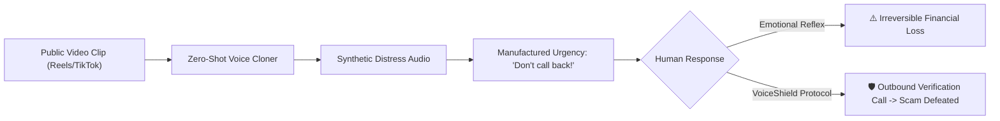

# VoiceShield 🛡️ — AI Voice Scam Awareness Tool

> **“Never trust a voice alone. Verify before you act.”**  
> An interactive educational cybersecurity tool built to raise awareness about neural voice-cloning scams and teach out-of-band verification protocols.  
> *Created as a built-in-public initiative for tech creator brand **The Build Brief**.*

---

[](https://vitejs.dev/)
[](https://reactjs.org/)
[](https://www.typescriptlang.org/)
[](https://tailwindcss.com/)
[](LICENSE)

---

## 📖 Table of Contents
- [Project Overview](#-project-overview)
- [The Problem](#-the-problem)
- [Design & Aesthetics](#-design--aesthetics)
- [Core Features](#-core-features)
  - [1. Interactive Scam Simulator](#1-interactive-scam-simulator)
  - [2. Suspicious Call Safety Checker](#2-suspicious-call-safety-checker)
  - [3. What To Do If You Suspect a Scam](#3-what-to-do-if-you-suspect-a-scam)
  - [4. Family Safe Word Generator & Drill](#4-family-safe-word-generator--drill)
  - [5. Knowledge Vault](#5-knowledge-vault)
- [Honest Limitations & Ethical Disclaimer](#-honest-limitations--ethical-disclaimer)
- [Tech Stack](#-tech-stack)
- [Getting Started Locally](#-getting-started-locally)
- [Content Creator Kit (30s Reel Script)](#-content-creator-kit-30s-reel-script)
- [Built in Public (The Build Brief)](#-built-in-public-the-build-brief)
- [License](#-license)

---

## 🌟 Project Overview

**VoiceShield** addresses one of the fastest-growing attack vectors in cybercrime: **AI-enabled voice cloning (neural audio impersonation)**.

With modern zero-shot voice models, an attacker can extract just 3 to 10 seconds of clear speech from public social media videos (Instagram Reels, TikToks, YouTube, podcast clips) and generate emotional, convincing voice audio in real time.

Rather than selling unproven "AI detector" algorithms that give users a false sense of security, VoiceShield focuses on **human verification instincts**: teaching people never to rely on an auditory cue alone, and how to verify requests via **independent, out-of-band communication channels**.

---

## ⚡ The Problem



1. **Emotional Amygdala Hijack**: Scammers pair cloned voices with simulated crying, sirens, or hospital sounds to shut down critical thinking.
2. **Channel Control**: Attackers explicitly command *"My phone battery is 1%, don't call me back!"* so the victim doesn't attempt two-way verification.
3. **Biological Blind Spot**: The human brain naturally equates hearing someone's familiar voice with their physical identity.

---

## 🎨 Design & Aesthetics

Tailored for high visual impact on screen recordings, YouTube demos, and social media reels:

- **Cybersecurity Theme**: Dark Plum (`#171326`), Deep Abyss (`#110d1e`), Accent Lavender (`#BFA2FF`), Accent Neon Lime (`#DFFF75`), and Warm White (`#F7F3ED`).
- **Interactive UI**: Animated audio waveform visualizers, phone call mockups, glowing indicators, cyber grid textures, and smooth transitions.
- **Audio Synthesis Engine**: Built-in Web Audio API synthesizers (telecom ringers, alert tones, success chimes) and browser SpeechSynthesis support—no external audio files required.

---

## 🚀 Core Features

### 1. Interactive Scam Simulator
The centerpiece of the application drills users through 3 realistic high-stakes scenarios:
1. **The "Don't Call Back" Urgent Voice Note**: An alleged best friend stranded at a transit station demanding immediate funds while insisting their phone is dying.
2. **The Family Member Distress Call**: A sobbing, hyperventilating family member alleging a car accident and begging for legal settlement cash.
3. **The Bank "Fraud Security" Department Alert**: An authoritative caller claiming an unauthorized debit and requesting an OTP to cancel the transfer.

**Key Mechanics**:
- Multi-choice interactive drill (`Option A`, `Option B`, `Option C`).
- Immediate feedback detailing **why** a decision is safe or dangerous.
- Specific emphasis: **Banks and payment providers NEVER ask for OTPs or PINs over the phone.**
- Final Quiz Performance Score with celebratory confetti and honest score disclaimer.

### 2. Suspicious Call Safety Checker
An interactive checklist evaluating the 6 core manipulation indicators:
- [x] The caller creates extreme urgency.
- [x] They demand money or gift cards.
- [x] They tell you to keep the request secret.
- [x] They discourage you from calling back.
- [x] They ask for OTPs, PINs, or passwords.
- [x] They demand payment through unusual channels.

**Dynamic Result States**:
- *“Pause and verify.”*
- *“Several warning signs detected.”*
- *“Never share confidential credentials.”*

### 3. What To Do If You Suspect a Scam
A structured 6-step incident playbook:
1. **Stop**: Freeze all actions and do not send money immediately.
2. **Outbound Call**: Dial the person directly using a known, pre-saved phone number.
3. **Mutual Contact**: Verify with a trusted friend, partner, or colleague if they do not answer.
4. **Zero Credential Sharing**: Never verbalize OTPs, passwords, or PINs.
5. **Preserve Evidence**: Save screenshots, transaction IDs, and audio without sharing personal data.
6. **Report Immediately**: If money was lost in India, promptly dial the **1930** Cybercrime Helpline and file a case at **[cybercrime.gov.in](https://cybercrime.gov.in/)**.

### 4. Family Safe Word Generator & Drill
An offline challenge-response tool:
- Generates un-guessable, memorable two-word secret phrases (e.g., *“Cobalt Bicycle”*).
- Interactive verification drill to test the family safe word protocol against an imposter.
- Emphasizes zero-cloud storage (never store safe words in WhatsApp, SMS, or Google Keep).

### 5. Knowledge Vault
Educational modules breaking down:
- How neural speech synthesis algorithms work.
- Why familiar voices are no longer proof of identity.
- How caller ID spoofing works over telecom networks.

---

## 🛡️ Honest Limitations & Ethical Disclaimer

> [!IMPORTANT]
> **VoiceShield is an educational awareness prototype, NOT an automated fraud-detection system.**
> - It does **not** process live phone lines or claim to classify audio as synthetic vs. authentic in real time.
> - The application stores **zero** personal data, phone numbers, or passwords.
> - A legitimate caller can sound urgent, and the absence of warning signs does not guarantee authenticity.
> - Always perform independent out-of-band verification before transferring money.

---

## 💻 Tech Stack

- **Framework**: [React 18](https://react.dev/) + [TypeScript](https://www.typescriptlang.org/)
- **Bundler & Dev Server**: [Vite 5](https://vitejs.dev/)
- **Styling**: [Tailwind CSS v3](https://tailwindcss.com/)
- **Icons**: [Lucide React](https://lucide.dev/)
- **Audio**: Web Audio API (oscillators, biquad filters, gain nodes) & Web Speech API
- **Visual Micro-Interactions**: Custom SVG/Canvas Waveforms, CSS Glow Animations, [canvas-confetti](https://www.npmjs.com/package/canvas-confetti)

---

## 📦 Getting Started Locally

### Prerequisites
- [Node.js](https://nodejs.org/) (version 18 or newer recommended)
- `npm` (comes bundled with Node.js)

### Installation

1. Clone this repository:
   ```bash
   git clone https://github.com/YOUR_USERNAME/voiceshield.git
   cd voiceshield
   ```

2. Install dependencies:
   ```bash
   npm install
   ```

3. Launch the development server:
   ```bash
   npm run dev
   ```
   Open your browser at **`http://localhost:5173`**.

4. Build for production:
   ```bash
   npm run build
   ```

5. Preview the production build:
   ```bash
   npm run preview
   ```

---

## 🎬 Content Creator Kit (30s Reel Script)

Crafted specifically for tech creators on Instagram Reels, TikTok, and YouTube Shorts:

| Timing | Visual Action | Voiceover / Script |
| :--- | :--- | :--- |
| **0:00 - 0:05** | Phone mockup ringing on screen; audio waveform animating. | *"If you received this urgent voice note from your best friend asking for \$450, would you send it?"* |
| **0:05 - 0:11** | Zoom into VoiceShield Hero: *"That voice sounds familiar. But is it really them?"* | *"With AI voice cloning, scammers only need a 5-second video from Instagram to clone your friend's voice with pitch-perfect emotion."* |
| **0:11 - 0:20** | Simulator demo: Click **Option C** (Out-of-band call). Green `VERIFIED SAFE` badge pops up. | *"Inside VoiceShield, we drill how to stop these attacks. The golden rule? Never verify inside the same chat. Disconnect and call them outbound."* |
| **0:20 - 0:30** | Quick scroll through the **Family Safe Word Generator** and the **1930 Cybercrime Helpline**. | *"Set up an offline safe word with your family today. Try VoiceShield, built in public by The Build Brief. Link in bio!"* |

---

## 🛠️ Built in Public (The Build Brief)

**VoiceShield** was built as an open, transparent project for **The Build Brief**, exploring how software engineering, design, and cybersecurity awareness can intersect to demystify emerging AI threats.

- **Brand**: The Build Brief
- **Tagline**: *“Never trust a voice alone. Verify before you act.”*
- **Hashtags**: `#VoiceShield` `#TheBuildBrief` `#CyberSecurity` `#BuildInPublic` `#AIVoice`

---

## 📄 License

This project is open-source under the [MIT License](LICENSE).
Feel free to use it for educational workshops, awareness sessions, or fork it to build community protection tools.
